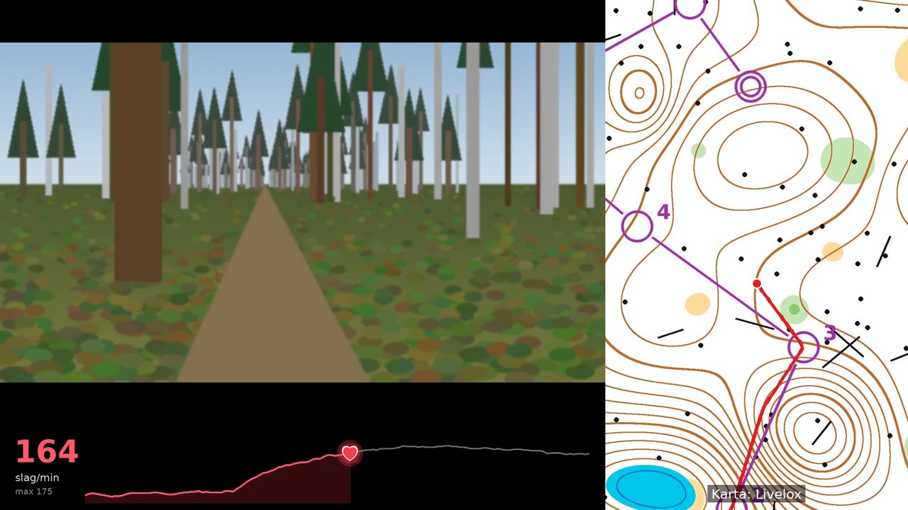
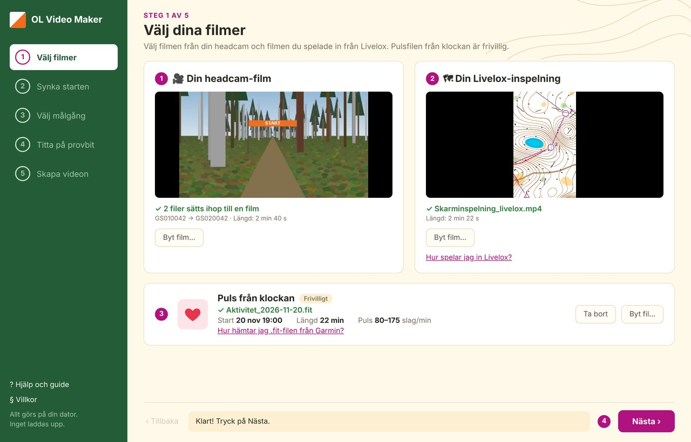
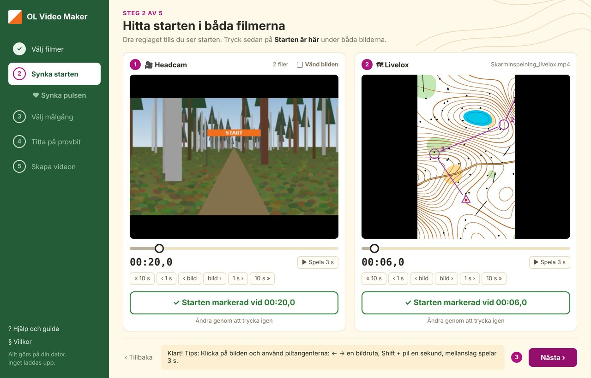
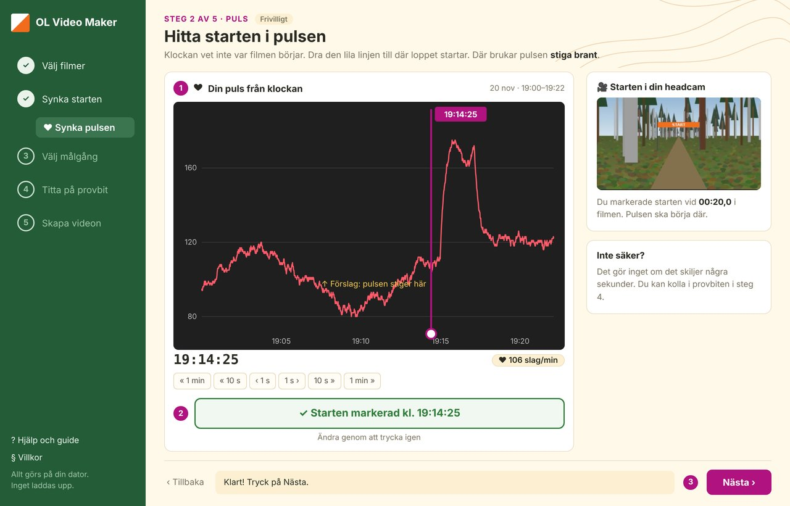
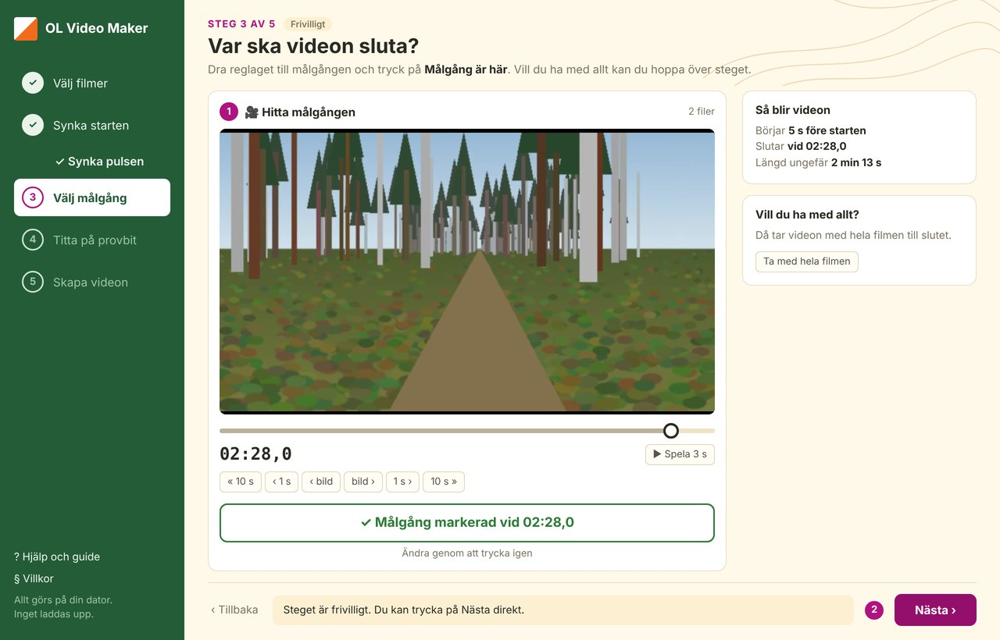
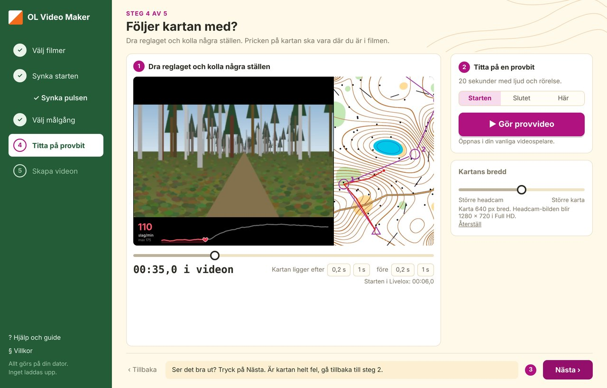
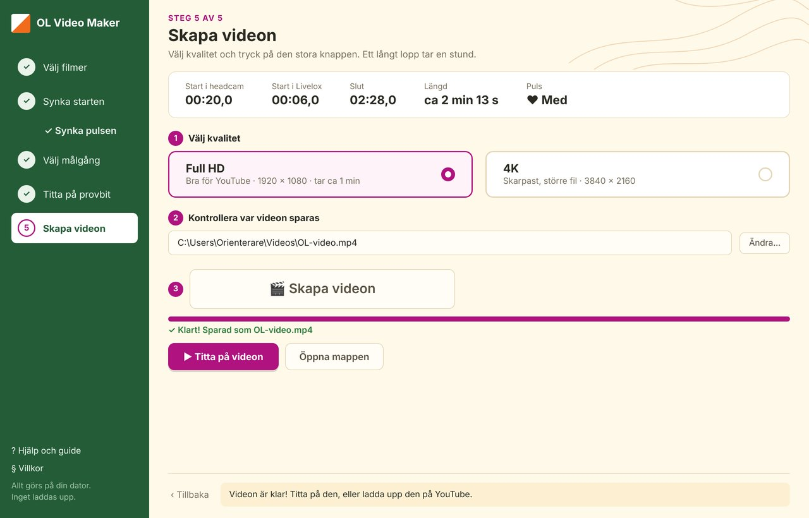

# OL Video Maker

Ett gratis program som gör en YouTube-video av din headcam-film (till exempel GoPro MAX)
och en skärminspelning från Livelox. Headcam-filmen är huvudbilden till vänster och
Livelox-kartan visas i en egen kolumn till höger, så kartan täcker aldrig headcam-bilden.

Allt körs på din egen dator. Den färdiga videon är 1920x1080, H.264 och AAC, som passar YouTube.

## Så ser programmet ut

Programmet är en guide i fem steg. Bilderna visar en påhittad demofilm, karta och puls.
Texten "Karta: Livelox" visar var källan anges i en riktig video.

| | |
|---|---|
| **1. Välj filmer** och, om du vill, pulsfilen från klockan  | **2. Synka starten:** visa var starten är i båda filmerna  |
| **2. Synka pulsen:** programmet föreslår var loppet startar  | **3. Välj målgång:** var videon ska sluta  |
| **4. Titta på provbit:** kolla att kartan följer med  | **5. Skapa videon:** välj Full HD eller 4K och tryck på knappen  |

👉 **Ny användare? Börja med [installationsguiden](docs/INSTALLERA.md).**
Sedan visar [steg-för-steg-guiden](docs/GUIDE.md) hur du spelar in Livelox och gör din video.
Programmets villkor finns i [VILLKOR.md](docs/VILLKOR.md).

## Kort version

1. Ladda ner zip-filen **OL_Video_Maker_..._windows.zip** (inte "Source code") från
   [senaste versionen](https://github.com/hoa79/ol_video_maker/releases/latest),
   packa upp den och dubbelklicka på **OL Video Maker.exe**. Godkänn villkoren första gången.
   Python och ffmpeg följer med, så inget behöver installeras.
2. Spela in Livelox-uppspelningen av ditt lopp på skärmen (guiden, del B).
3. Följ de fem stegen i programmet: välj filmer, synka starten, välj slutet, titta på en provbit
   och skapa videon.
   Vill du visa pulsen från din Garmin-klocka? Välj .fit-filen i steg 1 (frivilligt).

## Dela programmet med kompisar

**Prova en testversion:** varje PR bygger paketet automatiskt. Öppna körningen under fliken
**Actions** och ladda ner **OL_Video_Maker_windows** under **Artifacts** (sparas i 30 dagar).

**Släpp en version till kompisar:**

1. Öppna repot på GitHub och klicka på **Releases** och sedan **Draft a new release**.
2. Skriv en ny tagg, till exempel `v0.2.0`, välj **Create new tag** och klicka på **Publish release**.
   (Eller skapa och pusha taggen med git.)
3. GitHub bygger paketet och lägger zip-filen och ffmpegs källkod i releasen. Det tar några
   minuter. Tills dess finns bara källkodsfilerna som GitHub alltid lägger till.
4. Ladda ner zip-filen och dela den, till exempel via OneDrive, Google Drive eller WeTransfer.
   **Dela också `ffmpeg-7.1.tar.xz`** från samma release (ffmpegs licens, GPL, kräver att
   källkoden finns tillgänglig för den som får programmet). Är repot publikt räcker en länk
   till releasen.

Paketet har ingen köpt kodsignering, så Windows visar "Windows skyddade datorn" första gången.
Guiden (del A) förklarar hur man klickar förbi rutan.

## För utvecklare

- Fönster: `python -m ol_video_maker`
- Kommandorad:
  `python -m ol_video_maker --headcam GH010123.MP4 GH020123.MP4 --livelox livelox.mp4 --headcam-sync 02:15 --livelox-sync 00:04 --end 45:30 --out video.mp4`
- Tester (skapar egna testklipp med ffmpeg): `python -m unittest discover -s tests -v`

Programmet använder bara Pythons standardbibliotek och ffmpeg. Fönstret är en HTML-sida
(`ol_video_maker/web/`) som en liten lokal server (`ol_video_maker/webapp.py`, bara 127.0.0.1)
visar i ett eget appfönster i Microsoft Edge, som redan finns i Windows 10 och 11 (annars Chrome
eller vanlig webbläsare). Filväljarna är Windows egna rutor via tkinter.
Provkör sidan utan fönster: `OLVM_NO_WINDOW=1 python -m ol_video_maker` skriver adressen.
Pulsfilen från klockan (.fit) läses av en egen liten läsare i `ol_video_maker/fitfile.py`,
så inget extra bibliotek behövs.
- Bygga Windows-paketet för hand (på Windows): `pip install markdown==3.7` (med Python från python.org) och sedan
  `python packaging/build_windows.py --version 0.2.0`. Paketet hamnar i `build_win/`.

## Licens

Koden är licensierad under MIT (se [LICENSE](LICENSE)). ffmpeg installeras separat och har
sin egen licens (LGPL/GPL); programmet anropar ffmpeg som ett fristående program.

Windows-paketet skickar med ffmpeg 7.1 från gyan.dev (GPL v3) i mappen `ffmpeg/`, tillsammans med
ffmpegs licenstext, README (med byggkonfiguration) och `KALLKOD.txt`. ffmpegs källkod läggs
bredvid zip-filen i varje GitHub Release. Licenstexterna för Python och Tcl/Tk ligger i
`licenser/`, och alla komponenter listas i `TREDJEPART.txt`. Se [ffmpeg.org/legal.html](https://ffmpeg.org/legal.html).

OL Video Maker är inte kopplat till eller godkänt av Livelox.
