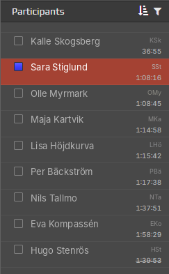
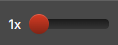
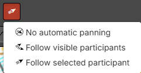

# Guide: Gör en YouTube-video av ditt orienteringslopp

Guiden har tre delar:

- **Del A:** Hämta och starta programmet (görs en gång).
- **Del B:** Spela in Livelox på skärmen i Windows.
- **Del C:** Gör videon.

Allt i guiden är gratis.

---

## Del A: Hämta programmet (görs en gång)

Här är en kort version. Den utförliga [installationsguiden](INSTALLERA.md) (även
**Installationsguide.html** i programmets mapp) visar varje steg och vad du gör om något krånglar.

1. Ladda ner zip-filen **OL_Video_Maker_..._windows.zip** från den senaste versionen:
   **https://github.com/hoa79/ol_video_maker/releases/latest**
   (eller använd länken eller filen du har fått av en kompis).
   Ladda **inte** ner "Source code". De filerna går inte att starta.
2. Högerklicka på zip-filen, välj **Extrahera alla** och klicka på **Extrahera**.
   Programmet fungerar inte om du startar det direkt inifrån zip-filen.
3. Öppna den uppackade mappen **OL Video Maker** och dubbelklicka på **OL Video Maker.exe**.
4. Första gången kan Windows visa en blå ruta med texten **"Windows skyddade datorn"**.
   Klicka på **Mer information** och sedan på **Kör ändå**.

   > Rutan visas för att programmet är nytt och inte har en köpt digital signatur.
   > Programmet är gratis och öppen källkod. Du behöver bara göra detta en gång.
5. Första gången visas programmets villkor. Läs dem, kryssa i **Jag har läst villkoren och
   godkänner dem** och klicka på **Godkänn och fortsätt**. Villkoren finns också i
   [VILLKOR.md](VILLKOR.md) och i **Villkor.html** i programmets mapp.
6. Vill du ha programmet på skrivbordet? Högerklicka på **OL Video Maker.exe** och välj
   **Skicka till** och sedan **Skrivbord (skapa genväg)**.

Python och ffmpeg följer med i mappen, så du behöver inte installera något annat.

### Om Windows spärrar ffmpeg

Windows 11 har ett skydd som heter **Smart appkontroll**. Det stoppar program som Microsoft inte
känner igen. Säger OL Video Maker att **"Windows spärrade programmet ffmpeg.exe"**, gör så här:

1. Kontrollera att du har packat upp hela zip-filen och att mappen **ffmpeg** finns i mappen
   **OL Video Maker**.
2. Starta om datorn och prova igen. Ibland känner Windows igen programmet efter en stund.
3. Fungerar det fortfarande inte, kontakta den som gav dig programmet och berätta vilket
   meddelande du fick.

Stäng **inte** av Smart appkontroll. Det skyddar din dator.

> **För dig som kör från källkoden:** installera Python från python.org (kryssa i
> "Add python.exe to PATH"), kör `winget install Gyan.FFmpeg` i ett cmd-fönster, starta om
> datorn och dubbelklicka på `Starta_OL_Video_Maker.bat`.

---

## Del B: Spela in Livelox på skärmen

Livelox-uppspelningen spelas in medan den spelas upp i webbläsaren. Programmet hämtar
aldrig något från Livelox automatiskt, du spelar själv in det du ser på skärmen.

Du gör det i nio steg. Samma steg finns i programmet under länken
**Hur spelar jag in Livelox?** i steg 1.

### Med Klippverktyget (Windows 11)

Steg 1–3 gör du i Livelox, steg 4–9 i Windows.

1. **Välj löparen** som ska visas. Kryssa i dig själv i listan **Participants**.
   Vill du visa flera? Kryssa i dem också.

    

2. **Välj uppspelningshastighet 1x.** Dra reglaget längst ner tills det står 1x.
   Annars går kartan inte i takt med headcam-filmen.

    

3. **Välj Follow selected participant.** Klicka på knappen uppe till vänster på kartan och
   välj det nedersta alternativet. Då följer kartan med dig hela loppet.

    

4. **Öppna skärminspelningen.** Tryck **Windows-tangenten + Shift + S**. Klippverktyget öppnas.
5. **Välj Video** (kameran) och dra en **smal, hög rektangel** över kartan. Den ska täcka hela
   sträckan från start till kontroll 1.
    - Rekommenderad storlek: **640 × 1080 pixlar** (bredd × höjd). Klippverktyget visar
      storleken medan du drar.
    - Kartan visas i en kolumn till höger i videon som är 640 × 1080 pixlar på YouTube
      (Full HD). Spelar du in lika stort blir kartan skarp.
    - Får rektangeln inte plats på skärmen? Tryck **F11** så att webbläsaren fyller hela
      skärmen, eller välj **540 × 900**. Då förstoras kartan lite och blir något suddigare.
    - Gör du video i 4K och har en 4K-skärm kan du välja **1280 × 2160**.
    - Zooma in i Livelox så att kartan syns tydligt, men så att din längsta sträcka får plats
      i rektangeln.
6. **Starta videoinspelningen.** Klicka på **Starta** i Klippverktyget.
7. **Starta uppspelningen i Livelox.** Klicka på play-knappen.

8. **Vänta tills hela banan är klar.** Det tar lika lång tid som ditt lopp. Ut och träna så länge!
9. **Stoppa inspelningen** när du har gått i mål på kartan. Windows sparar filmen i mappen
   **Skärminspelningar** under **Videoklipp**. Välj sedan den filen i steg 1 i programmet.

*Skärmbilder: Livelox. Namnen i deltagarlistan är påhittade.*

### Med Xbox Game Bar (Windows 10 och 11)

Gör först steg 1–3 ovan i Livelox.

1. Gör webbläsarfönstret smalt (ungefär hälften av skärmens bredd), så att kartan blir smal och hög.
2. Tryck **Windows-tangenten + Alt + R** för att starta inspelningen.
3. Starta uppspelningen i Livelox.
4. Tryck **Windows-tangenten + Alt + R** igen för att stoppa.
5. Filen hamnar i mappen **Videoklipp\Captures**. (Hittar du den inte, öppna Xbox Game Bar
   med **Windows-tangenten + G** och klicka på **Visa mina inspelningar**.)

> Game Bar spelar in hela webbläsarfönstret. Det fungerar, men kartan blir mindre i videon än om du spelar in bara kartan med Klippverktyget.

---

## Del C: Gör videon

Programmet leder dig genom fem steg. Till vänster i fönstret ser du alltid vilket steg du är på.
Du kan alltid klicka på **Tillbaka** och ändra.

1. Kopiera filerna från din GoPro till datorn. Ett långt lopp kan vara uppdelat i flera filer
   (till exempel `GS010123.MP4` och `GS020123.MP4`). Ta med alla.
2. Starta **OL Video Maker**.
3. **Steg 1, Välj filmer:**
   1. Klicka på **Välj headcam-film…** och välj din GoPro-fil. Är loppet uppdelat i flera
      filer, håll ner **Ctrl** och klicka på alla.
   2. Klicka på **Välj Livelox-inspelning…** och välj filen du spelade in (Del B).
      Har du inte spelat in än? Klicka på länken **Hur spelar jag in Livelox?** i programmet.
   3. **Under videon (frivilligt):** Fältet under headcam-bilden räcker till en sak. Välj
      **Ingenting**, **Puls**, **Höjd och fart** eller **Placering**.
      - **Puls:** Klicka på **Välj pulsfil…** och välj filen från klockan (se **Hämta
        pulsfilen från Garmin** nedan). Du kan välja zip-filen direkt.
      - **Höjd och fart:** Välj samma fil från klockan som för pulsen. Videon visar
        höjdkurvan, färgad efter farten: blå när det går långsamt, röd när det går snabbt.
        En liten löpare springer längs kurvan, fortare ju snabbare du springer. Klockan
        behöver ha haft GPS på under loppet.
      - **Placering:** Du klistrar in sträcktiderna från Livelox på nästa sida (se
        **Visa placeringen under loppet** nedan).
   4. Klicka på **Nästa**.
4. **Steg 2, Synka starten:** Nu ser du båda filmerna bredvid varandra.
   1. Är headcam-bilden upp och ner? Kryssa i **Vänd bilden**. Bilden vänds
      då också i den färdiga videon.
   2. Dra reglaget under headcam-bilden tills du ser **starten**, när du springer iväg.
   3. Finjustera med knapparna **10 s**, **1 s** och **bild** (en bildruta i taget).
      Du kan också klicka på bilden och använda piltangenterna. Maximera fönstret om du vill
      ha större bilder.
   4. Klicka på den stora lila knappen **Starten är här** under headcam-bilden. Knappen blir
      grön med en bock när starten är markerad.
   5. Gör samma sak i Livelox-bilden: leta upp ögonblicket när din prick börjar röra sig och
      klicka på **Starten är här**.
   6. Klicka på **Nästa**.
   7. **Synka pulsen** (bara om du valde **Puls** eller **Höjd och fart**): Klockan vet inte var filmen börjar, så
      du visar programmet var loppet startar i pulsen.
      1. Programmet har redan flyttat den lila linjen dit pulsen börjar stiga brant. Till
         höger ser du headcam-bilden från starten du markerade.
      2. Flytta linjen om det behövs: dra i pulskurvan eller använd knapparna
         **1 min**, **10 s** och **1 s**.
      3. Klicka på **Starten är här**. Knappen blir grön med en bock.
      4. Klicka på **Nästa**. Det gör inget om det skiljer några sekunder. Du ser pulsen i
         provvideon i steg 4.
5. **Steg 3, Välj målgång (frivilligt):** Dra reglaget till målgången och klicka på
   **Målgång är här**. Vill du ha med allt, klicka bara på **Nästa**. (Har du redan valt ett
   slut kan du klicka på **Ta med hela filmen**.)
6. **Steg 4, Titta på provbit:**
   1. Dra reglaget och titta på några ställen i loppet. Kartan till höger ska visa var du är.
   2. Välj **Starten** och klicka på **Gör provvideo** för att se 20 sekunder med rörelse och ljud.
      Provvideon öppnas i din vanliga videospelare.
   3. Ligger kartan **efter** filmen? Klicka på knapparna vid **Kartan ligger efter**.
      Ligger den **före**? Använd knapparna vid **före**.
   4. Välj **Slutet**, klicka på **Gör provvideo** och kontrollera att det stämmer även i slutet.
      Stämmer det i början men inte i slutet, spelades Livelox troligen inte upp i 1x hastighet.
      Spela då in Livelox igen.
   5. Vill du ha större headcam-bild? Dra reglaget **Kartans bredd** åt vänster. Kartan blir
      smalare och headcam-bilden större. Kartan täcker aldrig headcam-bilden.
   6. Klicka på **Nästa**.
7. **Steg 5, Skapa videon:**
   1. Välj **Full HD** eller **4K**. På valen står ungefär hur lång tid det tar på din dator
      (tiden räknas ut medan du tittar på sidan). Full HD räcker för de flesta. 4K blir
      skarpare men tar längre tid och ger en större fil.
   2. Kontrollera var videon sparas. Klicka på **Ändra…** om du vill spara den någon annanstans.
   3. Klicka på den stora knappen **Skapa videon**.
      Datorn hålls vaken tills videon är klar, men skärmen får släckas. Fäll inte ner locket
      på en bärbar dator, för då somnar den ändå. Har datorn sovit en stund fortsätter videon
      där den var när datorn vaknar, och programmet skriver hur länge den sov.
   4. När videon är klar, klicka på **Titta på videon** eller **Öppna mappen**.
   Med pulsfil visas hela loppets pulskurva i det svarta fältet under headcam-bilden. Den stora
   siffran till vänster är pulsen just då, och det röda hjärtat på kurvan slår i samma takt
   som ditt hjärta.
   Med placering visas en linje från start till mål med kontrollerna. Du och de du valde är
   prickar på linjen, där ni var vid samma lopptid. Siffran vid namnet är placeringen vid
   senaste kontrollen. En grön springande figur vinner minst 3 placeringar på sträckan, en
   orange trött figur tappar minst 3.
8. Ladda upp videon på YouTube. Programmet skriver **Karta: Livelox** längst ner i kartkolumnen
   (**Karta och sträcktider: Livelox** när placeringen visas).
   Skriv också i beskrivningen var kartan kommer från, till exempel:
   *Karta och GPS-spår: Livelox (livelox.com). Tävling: [namn], arrangör: [klubb].*
9. Om din YouTube-kanal tjänar pengar, fråga Livelox först. Ange gärna också tävlingen och
   arrangören, som äger kartan.

### Visa placeringen under loppet

1. Välj **Placering** under **Under videon** i steg 1 och klicka på **Nästa**.
2. Öppna loppet i Livelox, välj din klass och öppna sträcktiderna (**Split times**).
3. Markera hela tabellen med musen, från rubriken **Pl** till sista raden, och kopiera med
   **Ctrl + C**.
4. **1 Klistra in sträcktiderna:** Klicka i rutan i programmet och klistra in med **Ctrl + V**.
   Programmet skriver hur många löpare och kontroller det hittade.
5. **2 Vem är du?** Välj ditt namn i listan. Programmet minns namnet till nästa gång (klicka på
   **Glöm mitt namn** för att ta bort det). Är du inte med, eller vill du ha mer plats för
   linjen? Välj **Ingen, visa bara linjen**. Då visas ingen stor placeringssiffra.
6. **3 Välj vilka som syns:** Kryssa i upp till 8 löpare (du räknas med). Snabbknapparna
   **Topp 5 + du**, **Närmast dig** och **Din klubb** fyller i listan åt dig. Kolumnen längst
   till höger visar hur namnet skrivs i videon, till exempel **Anna B.**
7. Kryssa i **De jag visar med namn vet om det och tycker att det är okej** bara om du har
   frågat dem. Annars visas de andra bara med placering, utan namn.
8. Klicka på **Nästa** och fortsätt med steg 2.

Felstämplade löpare skrivs aldrig ut som felstämplade i videon. Pricken tonas bara bort vid
kontrollen som saknas. Löpare som inte startade går inte att välja. Sträcktiderna sparas bara
i programmet på din dator och skickas aldrig någonstans.

Andra löpares namn och placeringar är personuppgifter. Fråga dem du visar med namn innan du
lägger ut videon, och var extra försiktig med barn och ungdomar (se villkoren, punkt 3).

### Hämta pulsfilen från Garmin

1. Gå till **connect.garmin.com** i webbläsaren och logga in.
2. Öppna aktiviteten för ditt lopp.
3. Klicka på **kugghjulet** uppe till höger och välj **Export File**.
4. Du får en zip-fil. Välj den direkt i programmet (eller packa upp .fit-filen först).

Utan internet: anslut klockan till datorn med USB-kabeln. Filerna ligger i mappen
**GARMIN\Activity** på klockan. Den senaste filen är ditt senaste pass.

Pulsfilen läses bara på din dator. Den skickas aldrig någonstans. Men tänk på att pulsen syns
för alla som tittar på videon när du lägger upp den på YouTube. Vill du inte det, hoppa över
pulsfilen.

> Stänger du programmet medan en video skapas, frågar det om du vill avbryta. Den halvfärdiga
> filen tas då bort.
